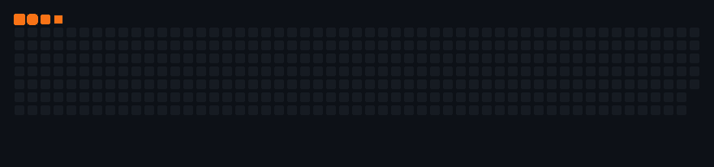

  <picture>
    <source media="(prefers-color-scheme: dark)" srcset="./dark.svg">
    <source media="(prefers-color-scheme: light)" srcset="./light.svg">
    
  </picture>

  
  
  

  <b>Construyo aplicaciones web de extremo a extremo.</b> 
  Estudiante de Ingeniería en Sistemas y Tecnología en Desarrollo de Software en la Universidad Tecnológica de Pereira. 
  Desde Dosquebradas, Colombia · Python · JavaScript · FastAPI · React · Node.js · SQL

---

## Proyectos destacados

<table>
  <tr>
    <td width="50%" valign="top">
      <h3>01 · Sistema de gestión de notas</h3>
      
Portal para registrar y consultar calificaciones, gestionar usuarios y asignaturas, y generar reportes.

      
<strong>Stack:</strong> Next.js · React · TypeScript · Supabase · PostgreSQL

      <a href="https://github.com/Craos6518/Proyecto-academico-version-andres">Ver código ↗</a> ·
      <a href="https://proyecto-academico-version-andres-git-main-craos-projects.vercel.app">Abrir aplicación ↗</a>
    </td>
    <td width="50%" valign="top">
      <h3>02 · Dungeon Crawler Patterns</h3>
      
Juego académico en Java 17 para demostrar patrones de diseño, con modos de consola y GUI, pruebas y documentación.

      
<strong>Stack:</strong> Java 17 · GUI · pruebas automatizadas

      <a href="https://github.com/Craos6518/dungeon-crawler-patterns">Ver código ↗</a>
    </td>
  </tr>
  <tr>
    <td width="50%" valign="top">
      <h3>03 · Smart Personal Finance Manager</h3>
      
Gestor financiero full-stack con asistente de IA para consultar ingresos, gastos y análisis personales.

      
<strong>Stack:</strong> Python · FastAPI · JavaScript · SQL

      
<code>Repositorio privado</code>

    </td>
    <td width="50%" valign="top">
      <h3>04 · To-Do List</h3>
      
Aplicación responsive para organizar tareas por categorías, prioridades y estados.

      
<strong>Stack:</strong> HTML · CSS · JavaScript

      <a href="https://github.com/Craos6518/Proyecto_To_Do_list_TMS-2024-2">Ver código ↗</a>
    </td>
  </tr>
</table>

  
<b>Más sobre mi trabajo</b>

   
  <b>Dashboard Analytics</b> — panel de visualización con gráficos interactivos, análisis de datos y consumo de APIs REST. Tecnologías: JavaScript, Node.js, Express, MongoDB, HTML y CSS.
    
  <b>Experiencia</b> — atención al cliente y resolución de consultas técnicas en Claro Traslados (Atento, 2023) y Movistar (Abai Group, 2023).
    
  <b>Formación</b> — Ingeniería en Sistemas y Computación (6.º semestre); Tecnología en Desarrollo de Software (5.º semestre, penúltimo); Técnico en Implementación y Mantenimiento de Equipos Electrónicos Industriales (SENA, 2017–2018).
    
  <b>Certificaciones</b> — Fundamentos de Python (Cisco Networking Academy); Programación y Desarrollo de Software (Platzi Expert); Ciberseguridad y Privacidad para Empresas (Platzi).

## Herramientas

  
  
  
  
  
  
  
  
  
  

## Actividad en GitHub

<picture>
  <source media="(prefers-color-scheme: dark)" srcset="./assets/github-snake-dark.gif">
  <source media="(prefers-color-scheme: light)" srcset="./assets/github-snake-light.gif">
  
</picture>

---

  ¿Tienes una idea o una oportunidad para colaborar? 
  <a href="mailto:f.martinez5@utp.edu.co"><b>Hablemos por correo ↗</b></a>

